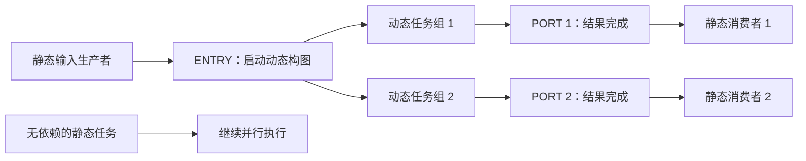

# Insight 概念覆盖检查
检查范围：目录中全部 Markdown 与 HTML 内容文件。先建立逐文件目录与标题索引，再对下列未覆盖概念读取原段落并与六篇正文核对。不是对 Insight 所有技术结论的重新验证；历史数字与产品建议不作为当前实现事实。

本次清点 **34 个内容文件**，其中空文件也明确保留。详细标题与哈希见 [目录记录](insight-inventory.json)。

## 明确尚未解释的概念

<a id="layout"></a>
### Tensor/Tile 布局与坐标
材料：`Insight/PTO3写算子过程中的硬件内存感知与配置.md:125–153`。
02 解释类型与存储分离；未解释 ND/DN/NZ、stride、start_offset 的坐标变换。
优先补充，直接影响地址和数据搬运的阅读。
<details><summary>本次核对的原文片段</summary>

```text

Tile 侧需要关注：

| 参数 | 作用 |
|---|---|
| `blayout` | block layout，如 `row_major`、`col_major` |
| `slayout` | scatter / box layout，如 `none_box` |
| `fractal` | 分形尺寸参数 |
| `stride` | 各维元素步长 |
| `valid_shape` | 有效数据区域 |
| `start_offset` | 视图在底层 buffer 中的起始偏移 |
| `pad` | 越过有效区域时的填充值模式 |

PTO codegen 会根据这些字段生成 `pto.alloc_tile` 的 `loc`、`rows`、`cols`、`blayout`、`slayout`、`fractal` 和 `pad` 属性。

### 4.2 TensorView 参数

Tensor 侧主要使用：

- `shape`
- `stride`
- `layout`：`ND`、`DN`、`NZ`
- `valid_shape`
- `pad`

`MaterializeTensorStrides` 会把隐式 stride 展开为显式 stride。`NZ` 是分形布局，主要用于 Tile，不适用于普通 Tensor 的 flat stride 表达。

### 4.3 `valid_shape` 与边界 Tile

```

</details>

<a id="ring"></a>
### 运行时 ring 与内存池
材料：`Insight/PTO3写算子过程中的硬件内存感知与配置.md:391–404`。
02 聚焦片上规划，未解释 task window、heap、dep pool 的资源寿命与容量。
可独立成图解，不能并入同一片上地址域。
<details><summary>本次核对的原文片段</summary>

```text
## 11. 运行时 Ring 资源

除了算子数据 buffer，PTO3 运行时还需要 task ring 资源：

| `RunConfig` 参数 | 作用 | 约束 |
|---|---|---|
| `ring_task_window` | 在途 task slot 数量 | 2 的幂，至少 4 |
| `ring_heap` | 每个 ring 的 task 输出堆大小 | 2 的幂，至少 1024 字节 |
| `ring_dep_pool` | 依赖边池容量 | `[4, INT32_MAX]` |

这些参数不直接决定 Tile 的片上地址，但会影响任务并发、依赖图规模和运行时内存压力。

## 12. 写算子时的检查清单

```

</details>

<a id="roofline"></a>
### 算术强度与 Roofline
材料：`Insight/05Operator-hardware.md:721–785`。
03 是编译决策关系，不包含计算/带宽下界及算术强度推导。
建议后续硬件性能专题。
<details><summary>本次核对的原文片段</summary>

```text
# 05.12 Compute-bound 与 Memory-bound

理解 Kernel 性能最重要的两个概念之一就是：

```text
Compute-bound
```

和：

```text
Memory-bound
```

假设 Kernel 需要进行很多计算，但是只读取少量数据：

```text
少量 Memory Traffic
        ↓
大量 FLOPs
```

那么瓶颈可能出现在计算单元：

```text
Compute-bound
```

反过来，如果：

```text
读很多数据
   ↓
只做很少计算
```

那么计算单元经常处于等待数据状态：

```text
Memory-bound
```

因此：

> **Kernel 快慢不能只看 FLOPs，还必须看为了这些 FLOPs 搬运了多少 Byte。**

---

# 05.13 Arithmetic Intensity：把 Compute 和 Memory 联系起来

Roofline Model 中最重要的概念是 Arithmetic Intensity：

[
AI=
\frac{\text{Operations}}
{\text{Memory Traffic}}
]

单位通常可以理解为：

```text
FLOP / Byte
```

例如：
```

</details>

<a id="serving"></a>
### KV 管理、动态组批与 P/D
材料：`Insight/knowledge-map.md:188–238`。
05 提到计时范围，不解释 Serving Scheduler、Prefix Cache、Paged KV、P/D 的机制。
单独的 Serving 系列。
<details><summary>本次核对的原文片段</summary>

```text
进入这一层以后，问题从“模型怎么算”转变成：

> **大量 Request 到达之后，当前这个 step 应该计算哪些 Request。**

核心对象包括 Request Queue、Scheduler、Continuous Batching、Batch Formation、Paged KV Cache、Prefix Cache、Chunked Prefill、Preemption、Speculative Decoding 和 Sampling。

可以把 Serving Runtime 抽象为：

```text
Request Queue
      ↓
   Scheduler
      ↓
Continuous Batch
      ↓
Model Executor
      ↕
KV Cache Manager
      ↓
   Decoder
```

KV Cache 在这一层已经不只是一个 Tensor，而成为需要动态分配、复用、回收甚至跨实例传输的系统资源。TensorRT-LLM 当前官方 KV Cache System 使用 Block Pool，根据 Request 动态分配 KV Blocks，并支持跨请求 reuse、offloading 和 prioritized eviction，这正是为什么 KV Cache 应该同时出现在“推理原理”和“Serving Runtime”两个层级。

---

## 08. Production / Distributed Serving：从一个 Model Instance 到在线推理系统

这一层讨论完整生产系统如何组织多个 Model Instance，并持续满足请求吞吐、延迟和稳定性目标。

典型关系可以抽象为：

```text
                  Request Stream
                        ↓
                Gateway / Router
                        ↓
                    Scheduler
               ┌────────┼────────┐
               ↓        ↓        ↓
           Instance A Instance B Instance C
               ↓        ↓        ↓
        Distributed Model Execution
```

这里需要区分 **Scale-up** 与 **Scale-out**：前者扩大一个 Model Instance 的模型并行域，例如增加 TP/EP 规模；后者增加 Instance / Replica，让更多独立请求能够并行处理。

Prefill / Decode Disaggregation 是这一层的重要专题。Prefill 计算 Prompt 并产生 KV Cache，Decode 利用已有 KV Cache 逐 token 生成；由于二者计算特征不同，可以被部署到不同计算资源池，并在两者之间传输 KV Cache。TensorRT-LLM 当前官方明确区分 Aggregated Serving 与 Disaggregated Serving，并允许 Context 与 Generation 使用不同 GPU 池和不同 Parallelism Configuration，从而分别优化 TTFT 与 TPOT。

这一章还需要覆盖 Request Routing、Load Balancing、Replica、Autoscaling、Admission Control、Multi-node Serving、Failure Isolation 和 Multi-tenant Serving。

```

</details>

<a id="parallel"></a>
### TP/EP 与集合通信
材料：`Insight/knowledge-map.md:168–184`。
03 的核内流水不等于 TP/EP；05 的 Rank 身份不解释 AllReduce/All-to-All。
结合已有通信图解扩展；不混用核内 Task 依赖图。
<details><summary>本次核对的原文片段</summary>

```text
        ↓
Communication Semantics
        ↓
Collective / P2P
        ↓
Communication Group
        ↓
Rank Mapping
        ↓
Physical Topology
```

TP 需要理解为什么 Tensor Sharding 会产生 AllReduce、AllGather、ReduceScatter 等通信；EP 需要理解 Router、Token Dispatch、All-to-All、Expert Computation、Combine 和 Expert Load Imbalance；DP 则主要研究不同 Request / Batch 如何分布到不同计算设备。MindIE 官方对 DP 的定义就是将 inference requests 划分到不同计算设备并行处理，并允许与 TP 组合，例如 `tp × dp = worldSize`。

这一章还必须系统解释 Rank、World Size、Parallel Group、Node、Server、SuperNode，以及 NVLink/NVSwitch、HCCS/RoCE 等物理通信域。Ascend HCCL 当前已经为 Atlas A3 推理产品明确列出 inter-SuperNode Collective Communication 支持，因此 SuperNode 应理解为重要的物理通信域，而不能简单理解成推理绝对不能跨越的边界。

---
```

</details>

<a id="model"></a>
### Attention 表示与 KV Cache
材料：`Insight/02 Model Architecture & Inference Semantics.md:270–298`。
01 的 XW 案例不解释自回归、KV 保存、MHA/GQA/MLA。
沿已有 Transformer 图解扩展。
<details><summary>本次核对的原文片段</summary>

```text
# 02.4 KV Cache：为什么不需要每次重算所有历史 token

如果没有 KV Cache，生成第 1001 个 token 后，再生成第 1002 个 token 时，就可能需要重新计算：

```text
token 1
token 2
...
token 1000
token 1001
```

但在因果 Self-Attention 中，历史 token 的 K 和 V 在模型权重不变时已经确定。

因此第一次处理：

```text
token 1 → K1 V1
token 2 → K2 V2
...
token 1000 → K1000 V1000
```

可以直接保存：

```text
KV Cache
[K1 ... K1000]
[V1 ... V1000]
```

</details>

<a id="training"></a>
### Autograd、Tape 与 Checkpoint
材料：`Insight/pypto_training_中文深度解析报告_20260915.md:142–195`。
02 静态片上生命期不等同于反向保存值寿命；本系列未解释训练求导。
独立训练专题，注明设计提案成熟度。
<details><summary>本次核对的原文片段</summary>

```text
### 3.3 保存上下文是在声明反向依赖

保存什么应由导数公式决定：加法通常不需要保存输入；Sigmoid 可以利用输出；规约通常还需要原形状；Attention 可以保存行统计量并重算概率块。

这里必须区分三个对象：

1. **上下文引用**：哪个反向函数需要哪个值。
2. **物理 storage**：这个值实际占用哪块设备内存。
3. **版本**：反向需要前向时刻的值，不能被后续原地写破坏。

`save_for_backward(x)` 不应自动意味着复制整个 `x`，也不能只做引用计数而不保护版本。PyTorch 的官方说明明确通过版本计数检查保存后发生的原地修改；这一机制可作为契约设计参考。[PyTorch 原地正确性检查](https://docs.pytorch.org/docs/2.14/notes/autograd.html#in-place-correctness-checks)

另一个原文内部冲突出现在 §39：把 MoE 路由 index tensor 放入 `ctx.meta`，与 §5 的“tensor 走保存通道、meta 走非 tensor 通道”不一致。**整数索引不参与求导，但仍占设备内存且可能需要活到反向。**建议路由表使用受生命周期管理的 tensor 句柄，不能按“无需梯度”归为零成本元数据。[原文 §39](https://github.com/hw-native-sys/pypto_top_level_documents/blob/31bbf531444e399f256b298ff5804d3e58ee86ce/pypto_training.md#L1315-L1321)

### 3.4 Tape 的逆序是提交顺序，梯度完成仍需独立判定

原文认为，串行编排产生合法前向拓扑序，逆序即可提交反向，避免重新做拓扑排序。这在所述模型下有用，但应补充以下条件：

- 只遍历本次 loss 可达的求导子图。
- 每个输出及输入位置有明确梯度边；多输出函数不能只靠一个不加区分的节点计数。
- 反向任务提交不等于设备完成；计数减少和 SAVED 释放必须绑定真正的读取/计算完成事件。
- 源张量被多条路径使用时，要等全部有效梯度贡献完成后再消费累加结果。

**反例一：底层任务数不等于逻辑贡献数。** `h` 分别进入 Q、K、V 三个 Linear，在逻辑层有三份 `dh`。如果每个 Linear 展开为 100 个任务，底层读者可远多于三；还可能包含与求导无关的读取。不能把底层 fan-out 原值直接作为逻辑梯度等待数。

**反例二：并非所有前向消费者都贡献本次梯度。**

```text
y = 2*x
z = 3*x       # 不被 loss 使用
loss = y
```

本次 `dx=2`，只有一条有效贡献。如果按所有前向消费者等待两份，可能永远等不到 `z` 的梯度。`detach`、`no_grad` 和多个 loss 也会触发类似问题。

**建议：**分别维护“逻辑梯度贡献计数”和“具体缓冲区读写完成计数”；可复用计数基础设施，但映射必须明确。这直接修正 §8.5、§25.1 中过强的“直接复用 forward fan-out”表述。[原文 §8.3—§8.5](https://github.com/hw-native-sys/pypto_top_level_documents/blob/31bbf531444e399f256b298ff5804d3e58ee86ce/pypto_training.md#L429-L507)

### 3.5 Checkpoint：用额外前向换取较少长期保存

原文方案是把 checkpoint 区域变成一个外层 Tape 节点：前向保留边界输入及随机状态；反向时重新执行该区域，建立内部 Tape，再完成内部反向。[原文 §6.3](https://github.com/hw-native-sys/pypto_top_level_documents/blob/31bbf531444e399f256b298ff5804d3e58ee86ce/pypto_training.md#L213-L364)

它降低的是长期保存的激活，不会让内部数据从物理计算中消失。重算时仍需要工作集，有些内部值还要暂存到嵌套反向。

**成本修正。** 令原前向成本为 F、反向成本为 B，完整重算一次前向：

```text
原计算成本：F + B
重算后：    2F + B
反向阶段倍率：(F+B)/B
总计算倍率： (2F+B)/(F+B)
```

若仅作示例假设 `B=2F`，反向阶段变成 1.5 倍，总计算变成约 1.33 倍；不能普遍写成原文表格中的“反向约 2 倍”。实际时间还受通信、内存访问和重叠影响。

```

</details>

<a id="optimizer"></a>
### 梯度完成与参数版本
材料：`Insight/pypto_training_中文深度解析报告_20260915.md:272–327`。
未解释梯度累加、旧参数读取、优化器更新及 dtype 状态预算。
不可从普通 RAW/WAR 图直接推导训练更新安全。
<details><summary>本次核对的原文片段</summary>

```text
## 5. Part 3：完整训练 step 的关键是梯度何时真正完成

### 5.1 两种累加，两种寿命

原文的总体循环是：

```text
清零参数梯度
  → 微批 1 前向与反向
  → 微批 2 前向与反向
  → ……
  → 梯度同步（分布式时）
  → 优化器更新
```

激活梯度只需服务本次反向传播；参数梯度要累积到一个更新窗口结束。复用同一任务执行器是合理方向，但必须有完整的写入、归约、读取和更新依赖。[原文 §22—§28](https://github.com/hw-native-sys/pypto_top_level_documents/blob/31bbf531444e399f256b298ff5804d3e58ee86ce/pypto_training.md#L1012-L1145)

**`atomic_add` 只能避免某些丢失更新，不能独自回答这些问题：**

- 累加目标是否已经清零？
- 一共会产生多少份有效贡献？
- 最后一份贡献什么时候对消费者可见？
- 何时允许开始 all-reduce、读取梯度或修改参数？
- 权重共享时，后面的反向或重算是否还会读该权重？

原文提出“梯度完成后可提前优化参数”，还需要加上“所有旧版本参数读取已完成”。只等参数梯度 ready，对 tied weights 或重计算不足以保证安全。

### 5.2 梯度求和与梯度平均必须显式定义

如果每个等大微批的 loss 都取均值，连续调用 K 次 backward 默认得到 K 份微批平均梯度之和。要与整体大 batch 的平均 loss 对齐，应把每份 loss 乘 `1/K`，或最终统一缩放。

若每微批有效 token 数不同，应按真实样本/token 权重组合，而不总是平均 K 份均值。DP 的 SUM/平均语义还会再引入 rank 数因子。

**建议：**将 loss reduction、有效计数、微批归一化、DP reduction 一起记录为 step 契约。原文循环缺少这部分，因此不能直接视为数值等价的大 batch 示例。

### 5.3 “AdamW 占参数字节 4 倍”只对特定 dtype 组合成立

设参数元素数为 P，每类元素字节数分别为 `b_w、b_g、b_m、b_v、b_master`：

```text
M_persistent = P × (b_w + b_g + b_m + b_v + b_master)
```

| 明确假设 | 每参数元素字节 | 相对于计算权重字节 |
| --- | ---: | ---: |
| w、g、m、v 全部 FP32，无额外 master | 16 | 4 倍 |
| w 为 BF16，g/m/v 为 FP32，无额外 master | 14 | 7 倍 |
| 上一行再增加 FP32 master | 18 | 9 倍 |
| w/g 为 BF16，m/v/master 为 FP32 | 16 | 8 倍 |

这些是按字段求和的预算例子，不声称某一实现必定采用该配置。原文一面写“同 shape/dtype 的 grad”，一面将混合精度 master 留待扩展，不能据 `4×` 为真实混合精度训练直接配显存。[原文 §4.1、§26、§29](https://github.com/hw-native-sys/pypto_top_level_documents/blob/31bbf531444e399f256b298ff5804d3e58ee86ce/pypto_training.md#L1085-L1097)

完整设备预算还应包括通信 bucket、gather 缓冲区、任务图元数据、运行时工作区和保留容量。

---

```

</details>

<a id="replay"></a>
### 静态回放与动态区域
材料：`Insight/pypto_training_中文深度解析报告_20260915.md:399–473`。
04 解释静态函数变换；未解释构图缓存、回放摊销、dynamic hole 和一致性协议。
与编译图身份相邻但属于 runtime 计划专题。
<details><summary>本次核对的原文片段</summary>

```text
## 7. Part 5：缓存构图结果，而不是每轮重新发现依赖

### 7.1 为什么 C++ 编排仍然有动态成本

即使 Python 已经消失，每个 step 若仍逐任务执行依赖查询、集合去重、槽位分配及 wiring，仍在重复构图。

原文提出利用 `dep_gen`、`host_build_graph`、`prepared_callable` 组合 capture/replay。它把这些称为已存在的基础组件；本报告未检查对应运行时代码版本，因此只将其作为原文的复用主张。[原文 §46—§50](https://github.com/hw-native-sys/pypto_top_level_documents/blob/31bbf531444e399f256b298ff5804d3e58ee86ce/pypto_training.md#L1568-L1649)

一个可回放计划至少包括：任务与调用版本、显式依赖、相对内存地址、输入输出绑定表、就绪计数初值，以及说明适用条件的 guard。

**解析：**它是编译器与运行时之间的可执行合同。计划不仅应能“跑”，还应能解释“为什么这次允许复用”。

### 7.2 回放收益应按摊销计算

令：

- C：首次捕获、转换、验证和准备的额外成本。
- E：原 eager 一次执行耗时。
- R：回放一次耗时，包含 guard、重置、绑定及执行。

在 `E>R` 且不考虑缓存失效时，需要满足：

```text
n × (E - R) > C
```

示例假设 C=20 ms，每次节省 0.04 ms，大约 500 次重复才能覆盖额外成本。这是成本模型示例，不是 PyPTO 实测。

**适合优先评估：**重复多、边界稳定、构图成本占比高的区域。是否为 decode 不足以单独判断，实际请求长度、KV 状态、Shape bucket 命中和动态路由都会影响重复度。[原文 §51—§53](https://github.com/hw-native-sys/pypto_top_level_documents/blob/31bbf531444e399f256b298ff5804d3e58ee86ce/pypto_training.md#L1651-L1688)

### 7.3 静态计划的三个正确性条件

**第一，拓扑有效。** Shape 相同不一定依赖相同。data-dependent 索引、别名和路径必须纳入 guard，或者留在动态区域。编译产物版本、布局/stride、设备配置等也需要失效策略。

**第二，内存复用对所有允许调度都安全。** 捕获时观察到任务 A 先结束、B 后开始，不证明下一次并行调度仍如此。若 A/B 共用同一地址，应有明确的 happens-before 关系，或额外加入复用依赖；仅保存一次 trace 的时间顺序不够。

**第三，跨边界数据寿命完整。** 区域内部临时数据可以统一回收，但逃逸的输出、训练 SAVED 和外部别名必须由更长寿命的所有者管理。Part 5 的“区域退出整体释放”不能直接套在仍持有 SAVED 的前向训练区域上。

原文双通道依赖比较有助于检查捕获保真，但**同一套依赖分析器的两次结果一致，不能独立证明分析器没漏 WAR/WAW、内存复用合法或最终数值正确**。验证必须加入独立数值和内存检查。

### 7.4 动态 hole 最重要的是入口与出口解耦

MoE 的内部任务数量可以变化，但静态计划若能看到固定的输入与输出端口，就不必重新构建整个外部图。



构图函数返回只表示“提交结束”，不表示结果计算完成。原文 §62 的 ENTRY 加多个 PORT join，正确地区分了这两种完成。[原文 §62.4.3—§62.4.4](https://github.com/hw-native-sys/pypto_top_level_documents/blob/31bbf531444e399f256b298ff5804d3e58ee86ce/pypto_training.md#L2067-L2170)

**还需补充的协议：**

1. 出口在 fan-in 未绑定完成时，应处于不可触发状态。不能因为初始计数为零，就把“尚未注册生产者”误认成“确实没有生产者”。需要 seal/finalize 或等价协议。
2. 空出口必须有定义的输出或显式 absent 语义；“立刻完成”不等于可以读取未初始化内存。
3. 输出端口缓冲区要活到外部消费者结束，不能随 hole 私有 ring 一起释放。
4. 深度索引不等于作用域唯一身份。同深度并发 hole、或深度被 `MAX_RING_DEPTH` 截断后，不能默认仍有私有 arena。
5. 超出 slot 预算的 back-pressure 必须保留调度器进展能力；如果唯一执行构图的线程阻塞并占住执行资源，可能形成死锁。
6. 输出基数不能静态枚举时，可评估“容器句柄＋长度”或更大的动态区；是否必须全局 barrier 是实现选择，不是普遍数学结论。

### 7.5 Host 构图、Device 执行的前提是明确的一致性协议

原文讨论 Host 写入后设备缓存可能看不到更新，建议批量传输计划并在设备侧自主执行，避免逐边跨总线交互。这个分界有工程价值。

但 §57—§69 对特定 AICPU/AICore snoop 域、缓存指令和 Issue #822 的描述，本报告未独立核验到具体硬件手册及实现版本，因此不能当成所有昇腾设备通用事实。

**建议验收：**在目标芯片、运行时和进程路径下，分别验证 Host 发布、AICPU 读取、AICore 写回、完成标志可见性及跨轮复用。`release/acquire` 描述顺序，并不自动补足平台缺失的缓存一致性。

```

</details>

<a id="migration"></a>
### 迁移与低精度正确性
材料：`Insight/dpsk模型迁移.md:327–343`。
05 说明先验证正确性，但未解释误差传播、低精度校准与模型迁移能力差距。
单独数值验证专题。
<details><summary>本次核对的原文片段</summary>

```text
## 3.5 第五阶段：低精度计算与数值验证

DeepSeek 的低成本推理与低精度计算密切相关，但“支持低精度”不能只理解为硬件提供某一种 dtype。

在实际执行中，低精度策略涉及权重、Activation、通信 Tensor 和 KV Cache 分别采用什么格式，Scale 如何计算，量化和反量化发生在哪里，以及对应 Kernel 是否针对这种格式优化。

DeepSeek-V3/R1 的公开生产系统中，矩阵乘法和 Dispatch 使用 FP8，而核心 MLA 与 Combine 使用 BF16。 DeepSeek-V3.2 官方推理配置同样包含 FP8 dtype 和相应 scale format。

而当前 vLLM Ascend 官方 DeepSeek-V3.2 部署路径主要提供 W8A8 量化版本，并通过 `--quantization ascend` 进入 Ascend 的量化执行路径。

这说明迁移过程中不能建立简单的“GPU FP8 = NPU FP8”对应关系。真正需要验证的是：在目标 Ascend SKU 和软件版本上，采用何种数据格式能够同时满足显存、吞吐和精度要求。

因此，低精度迁移必须与 Correctness 验证同时进行。除了最终生成结果，还应根据测试目标观察 Logits、Logprob、关键 Layer Output 和中间 Tensor 的差异，从而区分模型精度变化和实现错误。

---

## 3.6 第六阶段：Expert Parallel 与通信优化
```

</details>

<a id="state"></a>
### 服务化状态契约
材料：`Insight/pypto-lib_开发者真实流程与体验机会分析_20260904.md:289–331`。
06 的 IRProperty 不等于服务状态机；未解释 reset/rebind 等状态场景回归。
保留服务状态矩阵为新的方法专题。
<details><summary>本次核对的原文片段</summary>

```text
### O3. 服务化契约中心 Contract Studio

**要解决的问题**：Shape、slot、cache、rank 和有效长度语义散落。

把契约从 Issue 文档升级为机器可读对象：

- 字段名、dtype、容量 Shape、运行时有效 Shape；
- source of truth 和废弃字段；
- per-request/per-token/per-rank 作用域；
- cache 写入、可见性、副本一致性和 padding 语义；
- Kernel、Golden、Serving adapter 各自消费的字段；
- 版本兼容矩阵和 Contract Diff；
- 自动生成 runtime assertion、fixture 和文档。

**关键设计原则**：契约变更必须能看到下游影响，而不只是代码搜索结果。

### O4. Failure-first 可观测性

**要解决的问题**：后续 timeout/stall 掩盖真正的首发硬件或任务异常。

- 按时间和因果链排序错误，突出 first fault；
- 将计算、内存、同步、等待、dispatch 和 idle 用不同语义呈现；
- 跨 Rank 对齐 task/barrier/notify/wait；
- 失败时仍保留泳道、依赖图和关键 Tensor；
- 对“分类器判断”和“原始证据”分别显示置信度。

### O5. 状态场景回归矩阵

**要解决的问题**：单次、固定输入验证无法覆盖服务状态机。

内置可组合场景：

- cold ↔ warm cache；
- fixed ↔ changing input；
- first run ↔ persistent worker reuse；
- aligned ↔ tail Shape；
- short ↔ long decode；
- single ↔ multi Rank；
- MTP on/off；
- prefix cache on/off；
- 连续重复与随机 seed sweep。

产品输出不是“跑了 20 次”，而是状态矩阵中哪些不变量在何处被破坏。
```

</details>

<a id="deps"></a>
### 运行时依赖边来源与提前派发
材料：`Insight/PyPTO性能调优方法论_基于Toolkit与案例.md:192–218`。
03 解释编译读写冒险；05 解释路径，未深入 creator/tensormap/explicit 边及 early resolve 资格。
优先后续补充，避免把传递约简等同可安全删边。
<details><summary>本次核对的原文片段</summary>

```text
### 步骤 5：审计依赖，解除伪串行但不破坏正确性

**需要看到**

- `deps.json` 的任务、Tensor、前驱/后继、`block_num`、shape/stride/offset；
- Full、Reduced、Omitted、Reduced DF、Omitted DF 五种图模式；
- 边来源 `explicit`、`tensormap`、`creator`，以及 DAG 深度；
- 连续单依赖分析和 Early Dispatch 状态。

**为什么看**

共享 GM 句柄、WAW、循环携带依赖和保守 dataflow 推断，可能让“很多任务”在很少的 Core 上串行执行。但删掉真实边会造成 race 或数据错误。

**如何分析**

- 先看 Full，确认原始图和任务类型；再看 Reduced/Reduced DF 聚焦可审计边；Omitted 模式用于查看被省略的边。
- 深度为 1 时不存在两跳路径，不能有传递冗余边，结束此项审计。
- `creator` 是生命周期保持边；有任何 `creator` 时，普通 Reduced 的 `0` 不是“图已最小”的证据，必须再看 Reduced DF。
- 图上的 `🔥` / `⭐` 表示提前派发的结构资格；它**不等于**本次运行已经提前派发成功。实际情况应回到 Scheduler View 的阶段记录验证。

**处置顺序**

1. 连续单入度/单出度链：评估融合、循环内化或 mixed kernel；
2. 同一 buffer 但写入区域实际不重叠：以最窄粒度使用 `no_dep_args`、`manual_dep=True` 或显式依赖；
3. 读任务被错误建模为 `INOUT`：恢复真实方向，改由 writer 显式控制依赖；
4. 需要同一图但更早派发：确认所有前驱条件后使用 `allow_early_resolve`；
5. 每次解除依赖后都重跑正确性和 CPM，绝不只看图更“漂亮”。
```

</details>

## 逐文件范围判定

| 文件 | 覆盖范围 |
| --- | --- |
| `Insight/02 Model Architecture & Inference Semantics.md` | 模型结构；Attention、MLA、MoE、KV 未作为本系列专题解释 |
| `Insight/05Operator-hardware.md` | 部分覆盖算子/核/分块；Roofline、向量化、访存模式未深入解释 |
| `Insight/09lingqu.md` | 空文件；没有可审计的概念 |
| `Insight/Ascend-ecosystem-whitepaper/index.html` | 生态定位与执行可追溯性；05 仅覆盖运行/编译证据，不覆盖产业判断 |
| `Insight/Ascend-ecosystem-whitepaper-plan.md` | 白皮书计划；不是新的技术概念来源 |
| `Insight/Ascend-ecosystem.md` | 生态定位与执行可追溯性；05 仅覆盖运行/编译证据，不覆盖产业判断 |
| `Insight/Ascend-ecosystem2-whitepaper/index.html` | 生态定位与执行可追溯性；05 仅覆盖运行/编译证据，不覆盖产业判断 |
| `Insight/Ascend-ecosystem2-whitepaper-plan.md` | 白皮书计划；不是新的技术概念来源 |
| `Insight/Ascend-ecosystem2.md` | 生态定位与执行可追溯性；05 仅覆盖运行/编译证据，不覆盖产业判断 |
| `Insight/PTO3写算子过程中的硬件内存感知与配置.md` | 部分覆盖片上存储；布局坐标、通信工作区和 runtime ring 未深入解释 |
| `Insight/PyPTO开发者体验洞察报告0818.md` | DX/生态/工具工作流；01–06 覆盖编译与诊断，环境、API、服务状态与协作流程只部分或未覆盖 |
| `Insight/PyPTO性能调优典型用户案例_基于GitHub_20260923.md` | DX/生态/工具工作流；01–06 覆盖编译与诊断，环境、API、服务状态与协作流程只部分或未覆盖 |
| `Insight/PyPTO性能调优方法论_基于Toolkit与案例.md` | DX/生态/工具工作流；01–06 覆盖编译与诊断，环境、API、服务状态与协作流程只部分或未覆盖 |
| `Insight/UX_Insight_Report（pypto仓）.md` | DX/生态/工具工作流；01–06 覆盖编译与诊断，环境、API、服务状态与协作流程只部分或未覆盖 |
| `Insight/_jit_decode_fwd_layers_20260625_184941_实际检测报告.md` | 案例材料；05 覆盖证据方法，未复述原案例的全部融合与实测结论 |
| `Insight/_jit_l3_decode_csa_20260903_010617_融合推荐报告.md` | 案例材料；05 覆盖证据方法，未复述原案例的全部融合与实测结论 |
| `Insight/dpsk开源.md` | 模型迁移/推理；06 种编译机制之外仍有数值、通信、Serving 概念 |
| `Insight/dpsk模型迁移-whitepaper/index.html` | 模型迁移/推理；06 种编译机制之外仍有数值、通信、Serving 概念 |
| `Insight/dpsk模型迁移.md` | 模型迁移/推理；06 种编译机制之外仍有数值、通信、Serving 概念 |
| `Insight/hw-native-sys-仓库功能洞察报告.md` | DX/生态/工具工作流；01–06 覆盖编译与诊断，环境、API、服务状态与协作流程只部分或未覆盖 |
| `Insight/knowledge-map-whitepaper/ds32_residual_architecture_v19_shape_in_legend.html` | 模型结构；Attention、MLA、MoE、KV 未作为本系列专题解释 |
| `Insight/knowledge-map-whitepaper/index.html` | 总体知识体系；编译是其中一部分，Serving/分布式/集群仍未覆盖 |
| `Insight/knowledge-map.md` | 总体知识体系；编译是其中一部分，Serving/分布式/集群仍未覆盖 |
| `Insight/nvidia_dynamo_ux_product_analysis.html` | Serving 产品分析；部署、调度与 KV 管理未解释 |
| `Insight/pypto-lib_开发者真实流程与体验机会分析_20260904.md` | DX/生态/工具工作流；01–06 覆盖编译与诊断，环境、API、服务状态与协作流程只部分或未覆盖 |
| `Insight/pypto-skills检测报告样例.md` | DX/生态/工具工作流；01–06 覆盖编译与诊断，环境、API、服务状态与协作流程只部分或未覆盖 |
| `Insight/pypto_training_中文深度解析报告_20260915.md` | 训练扩展；自动求导、保存值、优化器和回放未解释 |
| `Insight/pypto_ux_insights.md` | DX/生态/工具工作流；01–06 覆盖编译与诊断，环境、API、服务状态与协作流程只部分或未覆盖 |
| `Insight/pypto_ux_insights_zh（pypto仓）.md` | DX/生态/工具工作流；01–06 覆盖编译与诊断，环境、API、服务状态与协作流程只部分或未覆盖 |
| `Insight/pypto_开发者体验UX洞察报告_基于issues.md` | DX/生态/工具工作流；01–06 覆盖编译与诊断，环境、API、服务状态与协作流程只部分或未覆盖 |
| `Insight/remaining_repos_ux_insights（剩余6个仓）.md` | DX/生态/工具工作流；01–06 覆盖编译与诊断，环境、API、服务状态与协作流程只部分或未覆盖 |
| `Insight/ub-reference_1.html` | 部分覆盖片上存储；布局坐标、通信工作区和 runtime ring 未深入解释 |
| `Insight/梁文锋投资者交流会 · 录音文字稿.md` | 访谈与产业背景；六篇编译专题范围外 |
| `Insight/模型推理洞察报告_hw-native-sys_20260923.md` | 模型迁移/推理；06 种编译机制之外仍有数值、通信、Serving 概念 |